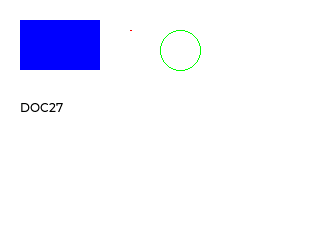

# UIFlow2 interface documentation validation

- Date: `2026-11-08`
- The overall result is `PARTIAL`. Documented API contracts and selected visible examples were validated within the recorded scope.
- This work covers documentation correction and virtual-device validation.
- The affected documentation covers Display parameter defaults, ADC imports and attenuation, method isolation, and the m5ui homepage example.
- The public source is [m5stack/uiflow-micropython @ f20d5a00e8c9106aae1d944f3d6f1128839f59cb](https://github.com/m5stack/uiflow-micropython/tree/f20d5a00e8c9106aae1d944f3d6f1128839f59cb).
- Execution used five fresh CoreS3 virtual devices, official UIFlow2 v2.5.5 **preview** base, native emulator runtime pinned by SHA256, controlled through the Device Service session API.

## Conclusion

The documentation patch corrects required versus optional Display arguments, ADC import and attenuation semantics, and m5ui automatic initialization and visible page loading in English and Chinese. Actual firmware accepted 58 complete/required-only calls for 29 Display methods and rejected 99 individually omitted required arguments. Four selected graphics/text behaviors have pixel evidence. ADC imports, six constructor cases and raw/u16 reads passed and calibrated `read_uv()` returned error 95 in all six cases and remains unsupported in this validation. m5ui automatic initialization and the exact revised rotation-0 example displayed all three labels. Rotation-1 state was correct, but the captured portrait surface is `PARTIAL`.

## Key evidence

- [Six-file documentation checks](evidence/documentation-checks-summary.json) and 54 code snippets compiled and final English/Chinese builds exited 0. Eight initial Chinese PO warning files were pre-existing and unchanged.
- [Applicable patch](patches/0001-interface-docs.patch), SHA256 `189798430297d06c8cf16e3019a6ba3ddb241bbd5d9861578c99fb75176160a0` and [public-base application proof](evidence/public-patch-application-summary.json).
- [Five session receipts](evidence/session-receipts-summary.json), with composed-image/runtime hashes, preserved native application bytes, ordered ownership/ZIP/retained-history checks and independently observed live runtime identities.
- [Display results](evidence/display-contract-results-summary.json), [ADC/m5ui results](evidence/adc-and-m5ui-results-summary.json), [image provenance](evidence/image-derivation-summary.json).

## Files

- [report.md](report.md) contains rationale, execution, conclusions, reproduction and limits.
- [run.json](run.json) contains the structured record.
- [evidence/session-receipts-summary.json](evidence/session-receipts-summary.json) contains bounded allowlist evidence with endpoint and identifier fields removed.
- [patches/0001-interface-docs.patch](patches/0001-interface-docs.patch) contains the six-file public-base patch.
- [code/README.md](code/README.md) lists the exact executed probes and fixtures.

## Uncovered or partial behavior

Full functionality of all 29 graphics methods, the other 14 keyword bindings, analog voltage accuracy, calibrated microvolts, physical hardware properties, and a complete portrait framebuffer are not established. The first host-wrapper import failure created no guest and the extra 14-method scratch expansion was prepared but never run. The executor completed normally, and the [coordinator receipt](evidence/executor-completion-summary.json) rechecks retained histories and runtime exit.
